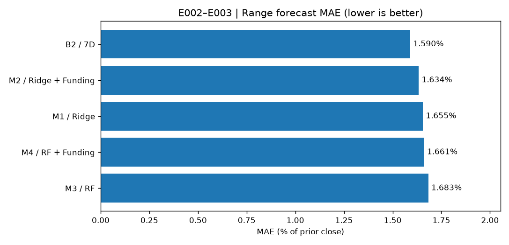

# Quantitative Research Lab — BTCUSDT

**Reproducible research on daily BTCUSDT futures returns and price ranges.**

This repository documents three empirical experiments (E001–E003), from data ingestion and chronological validation through a **single, pre-specified final holdout evaluation**. The focus is research discipline and falsifiable hypotheses—not producing a profitable trading signal.

> **Research status:** E001–E003 development studies completed; E002 final holdout evaluated once on 2026-11-21. Source publication timestamps have **not** been independently established, so the results are conditional on data-availability assumptions.

## Research questions

| ID | Question | Target | Outcome |
| --- | --- | --- | --- |
| **E001** | Does funding add information about next-day BTC returns? | `target_close_ret` | No robust improvement for the tested Ridge specification in development CV. |
| **E002** | Does funding help forecast the next daily high–low range? | `target_range` | It improved Ridge within development CV, but did not beat the 7-day range baseline on holdout MAE. |
| **E003** | Do nonlinear models improve range forecasts? | `target_range` | Fixed-hyperparameter Random Forest models did not beat the 7-day baseline on development CV MAE. |

The daily range target is defined as:

$$
\operatorname{target\_range}_t = \frac{H_{t+1}-L_{t+1}}{C_t}
$$

Features for day *t* are intended to be available after the UTC daily candle closes. The target describes day *t+1*. This is a **normalized high–low range**, not realized variance or a directional return.

## Key results

### Development: expanding-window, five-fold walk-forward

**E001 — next-day return** (1,030 pooled validation predictions):

| Model | MAE | RMSE |
| --- | ---: | ---: |
| Zero-return baseline | 0.016999 | 0.024424 |
| Market Ridge | 0.017329 | 0.024603 |
| Market + Funding Ridge | 0.017548 | 0.024781 |

**E002–E003 — next-day range** (same 1,030 development validation dates):

| Model | MAE | RMSE |
| --- | ---: | ---: |
| **B2: trailing 7-day mean** | **0.015903** | 0.022365 |
| M1: Market Ridge | 0.016550 | 0.022138 |
| M2: Market + Funding Ridge | 0.016339 | **0.021939** |
| M3: Market Random Forest | 0.016833 | 0.022333 |
| M4: Market + Funding Random Forest | 0.016615 | 0.022037 |

The simple 7-day mean achieved the lowest **MAE**, the pre-specified primary metric. Adding funding reduced the Ridge and Random Forest errors relative to their market-only versions, but those development improvements did **not** meet a nominal 5% threshold under HAC(7) comparisons (p ≈ 0.070 for Ridge; p ≈ 0.077 for Random Forest). These comparisons are exploratory and share validation periods.



### E002: one-time final holdout

The final 429 observations (feature dates **2025-09-13 to 2026-11-15**) were evaluated **once**, after freezing the models, metrics, and protocol. Ridge was fitted on **1,715** development rows with a **one-label-row purge** at the boundary.

| Frozen candidate | Holdout MAE ↓ | Holdout RMSE ↓ |
| --- | ---: | ---: |
| **B2: trailing 7-day mean** | **0.01379781** | 0.01997374 |
| M2: Market + Funding Ridge | 0.01380472 | **0.01902351** |

- **Primary endpoint (MAE):** effectively tied; M2 did not outperform B2. Paired absolute-loss comparison with HAC(7): **p = 0.98799**. This is not proof of model equivalence.
- **Secondary endpoint (RMSE):** M2 was approximately **4.76% lower** than B2. This descriptive difference was not the primary selection criterion and is not presented as a proven advantage.
- Models were **not tuned or reselected** after opening the holdout.

See [final research report (HTML)](reports/E001_E003_synthesis/E001_E003_FINAL_research_report.html), [Markdown version](reports/E001_E003_synthesis/E001_E003_FINAL_research_report.md), and the [frozen holdout protocol](reports/pre_holdout_audit/FINAL_HOLDOUT_PROTOCOL.md).

## Experimental safeguards

- Chronological expanding-window cross-validation; no random train/test shuffling.
- Dedicated holdout reserved until model selection was frozen.
- Median imputation and scaling fitted on each training fold, not the validation fold.
- Label-boundary purge used in E002/E003 CV and E002 final training.
- Raw funding-event aggregation and market feature construction audited against source records on development data.
- Saved predictions reproduced exactly for E001, E002, and E003 in the recorded environment.
- Results and source-file hashes recorded in experiment metadata and manifests.
- Final holdout evaluator protected against accidental re-execution. **Do not run it as part of normal setup.**

### Limitations

1. **Point-in-time publication:** source timestamps and reconstructed features were checked, but actual vendor release/availability timestamps were not independently verified. Do not present this as a fully proven historical information set.
2. **Researcher degrees of freedom:** E002/E003 explored several specifications on overlapping development periods; reported development p-values are exploratory and not adjusted for all comparisons.
3. **Single holdout:** one terminal assessment is informative but cannot establish robustness across every future market regime.
4. **No execution backtest:** transaction fees, slippage, funding cash flows, trading rules, leverage, and realized P&L were not evaluated. Forecast accuracy is not trading profitability.
5. **Data distribution:** raw/processed market datasets and prediction-level CSVs are intentionally not committed. A fresh download may differ from the frozen historical snapshot and **does not guarantee bit-for-bit reproduction** of published metrics.

## Repository layout

```text
config/            Research and agent-role configuration
src/quantlab/      Data checks, feature/target logic, research models
scripts/           Dataset preparation, audits, CV, reporting
experiments/       Research protocols for E001–E003
tests/             Automated tests
notebooks/         Interactive project inspection
reports/           Reports, metadata, summary metrics, audit artifacts
data/              Data directories (datasets excluded from Git)
```

The `agents/` module currently defines **roles only**. Autonomous LangGraph agents and live execution are **not implemented** in this repository.

## Environment setup

Requirements: **Python 3.12**, [`uv`](https://docs.astral.sh/uv/), and Git. Examples use PowerShell on Windows 11.

```powershell
uv python install 3.12
uv sync --locked
uv run python -m pytest -q
```

The dependency lockfile is `uv.lock`. The project contains development dependencies; `uv sync --locked` installs them under the current project configuration. You do **not** need to manually activate `.venv` when using `uv run`.

For a notebook environment:

```powershell
uv run jupyter lab
```

## Data setup and running research

The historical input files are **not** bundled. The main dataset used for the completed studies is `data/processed/btc_daily_features.csv`. To build a **new** dataset from supported external sources (subject to network access, vendor availability, and source terms):

```powershell
uv run python scripts/download_all_data.py --start-date 2021-01-01 --workers 6 --no-macro
uv run python scripts/run_data_check.py --input data/processed/btc_daily_features.csv
```

`--no-macro` avoids the macro source used during initial data collection; the studies reported here used the market/funding/range features. Do **not** mistake a new download for the frozen dataset: check the hashes in `reports/pre_holdout_audit/E002_FROZEN_MANIFEST.json` before comparing runs.

Development-only workflows (after the required dataset and derived E002 development file have been prepared):

```powershell
uv run python scripts/run_e001.py --phase audit
uv run python scripts/run_e001.py --phase cv
uv run python scripts/run_e002_target_audit.py
uv run python scripts/run_e002_baselines.py
uv run python scripts/run_e002_ridge.py
uv run python scripts/run_e002_funding.py
uv run python scripts/run_e003_rf.py
```

These commands may regenerate existing development reports; use a separate working copy if you wish to preserve the original research artifacts. The **final holdout evaluator is deliberately omitted** from the run instructions because the test has already been performed once.

## Audit trail and reports

- [E001 development summary](reports/E001_funding_rate/E001_cv_summary.md)
- [E002 target audit](reports/E002_range/target_audit.json)
- [Funding source-to-feature audit](reports/E002_range/funding_point_in_time_audit.json)
- [Market feature causality audit](reports/pre_holdout_audit/market_feature_causality_audit.json)
- [Frozen evaluation protocol](reports/pre_holdout_audit/FINAL_HOLDOUT_PROTOCOL.md)
- [One-time holdout summary](reports/E002_final_holdout/holdout_summary.json)
- [Final research report](reports/E001_E003_synthesis/E001_E003_FINAL_research_report.md)

## Scope and responsible use

Research and educational use only. No trading orders are executed; no investment advice or claim of profitable trading performance is made. Historical data usage remains subject to the respective providers' terms and applicable permissions.
