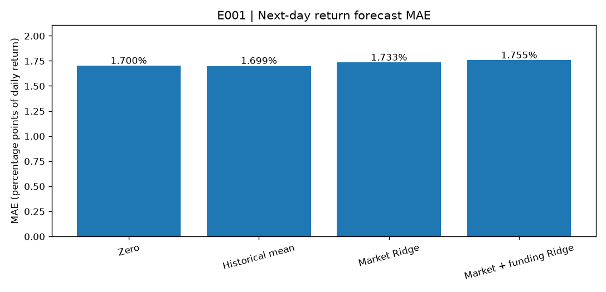
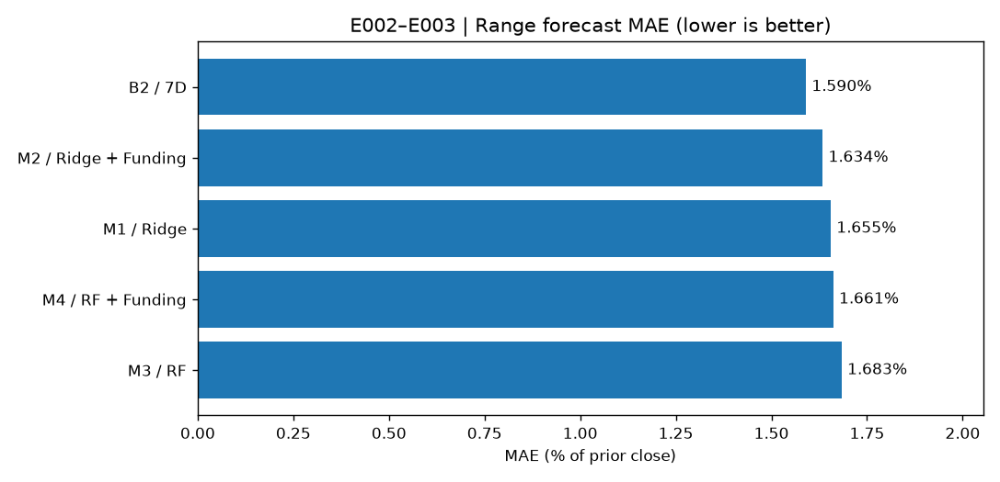
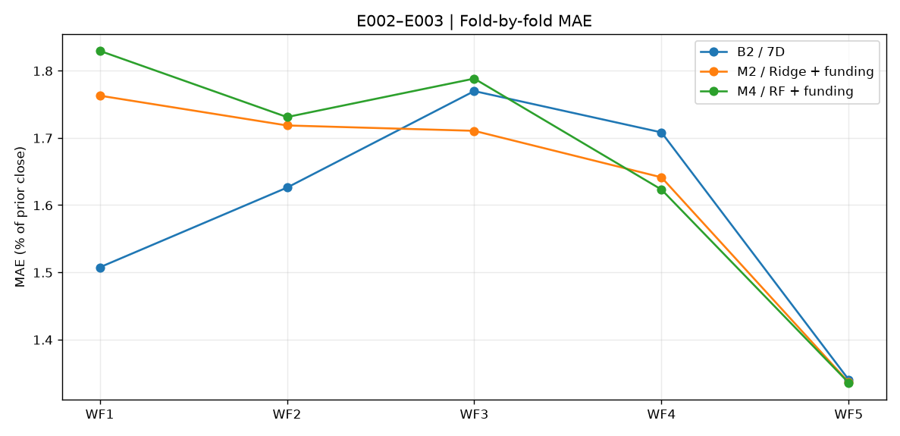
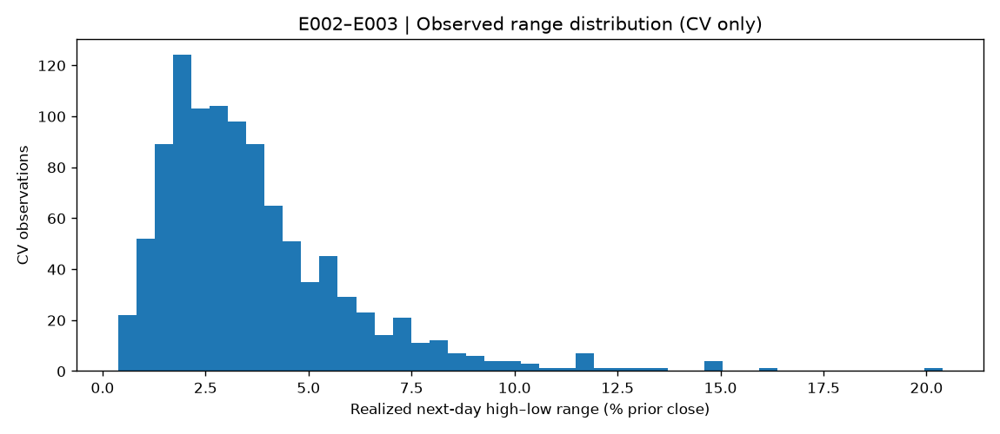

# Quantitative Research Lab — Research Synthesis E001–E003

**Status:** DEVELOPMENT-ONLY | EXPLORATORY | **FINAL HOLDOUT NOT EVALUATED**  
**Generated:** 2026-11-21 12:47 UTC  
**Instrument:** Binance BTCUSDT USD-M futures | **Daily UTC**  
**Development rows:** 1716 | **CV forecasts:** 1030 | **Reserved holdout:** 429  
**Source feature SHA-256:** `8fdea00914b36b8afff0677371cef1298557b90e1f1caaf600e8b530102d9c47`

## Executive summary

- **E001 (next-day return):** Funding features do not help Ridge in this tested specification; the zero-return baseline outperforms both Ridge variants on pooled MAE. The funding comparison is sensitive to the earliest validation fold.
- **E002 (next-day high–low range):** The simple **7-day trailing range mean (B2)** has the lowest pooled MAE. Adding funding improves Ridge's MAE, but the exploratory HAC(7) comparison is not significant at 5%.
- **E003 (nonlinear range):** Adding funding improves Random Forest, but this model still loses to B2 on pooled MAE. Extra complexity does not demonstrate a robust MAE advantage.
- **Decision:** Freeze models and protocol; audit point-in-time timing, feature pipelines and rerun reproducibility **before any single final holdout evaluation**.

## 1. Research questions and targets

**E001:** Does funding rate incrementally improve next-day signed return forecasts over a market-feature Ridge? The target is `target_close_ret`.  
**E002–E003:** Does funding improve forecasts of the next-day **high–low range**, and does nonlinear modeling beat simple volatility persistence? The target is:

`target_range[t] = (high[t+1] - low[t+1]) / close[t]`

Prediction is made **after the UTC close of day t**. This is a normalized range, not intraday realized variance. The return and range targets **must not be ranked together**.

## 2. Data and evaluation protocol

- Base period: 2021-01-01 through 2026-11-15 feature days; 2145 labeled rows.
- Development: 1716 chronological rows; final reserve: 429 rows. No holdout labels were accessed by this report generator.
- Five expanding-window validation folds; 1030 forecast dates, no duplicated dates. A one-day training/validation label purge is recorded in M2 E002 metadata.
- Preprocessing recorded for Ridge: train-fold-only median imputation and standardization. Ridge `alpha=10` fixed. RF settings fixed: 300 trees, `max_depth=6`, `min_samples_leaf=20`, `max_features=0.8`, `bootstrap=True`, random seed 2026.
- Primary metric: pooled **MAE**; secondary: **RMSE**. Differences use paired absolute losses with indicative HAC(7) inference. Exploratory Holm adjustment across the seven *displayed* comparisons is included; it is **not** a correction for all prior research choices.
- This report reads **only CV prediction files, experiment metadata and past audits**, never the full market dataset or holdout files.

## 3. E001 — return forecasting

| Model | MAE | RMSE |
|---|---:|---:|
| `M0_mean` | 1.6991% | 2.4504% |
| `M0_zero` | 1.6999% | 2.4548% |
| `M1_market` | 1.7329% | 2.4737% |
| `M2_market_funding` | 1.7548% | 2.4937% |

**Interpretation.** In this configuration, additional funding features worsen Ridge's pooled MAE. A negative result is a valid experimental finding, but not proof that funding has no predictive information in any model or horizon.

## 4. E002–E003 — daily range forecasting

| Model | MAE | RMSE |
|---|---:|---:|
| `B2_mean_7` | 1.5903% | 2.2365% |
| `M2_market_funding_ridge` | 1.6339% | 2.1939% |
| `B3_mean_30_exploratory` | 1.6401% | 2.2879% |
| `M1_market_ridge` | 1.6550% | 2.2138% |
| `M4_market_funding_rf` | 1.6615% | 2.2037% |
| `M3_market_rf` | 1.6833% | 2.2333% |
| `B1_persistence` | 1.9052% | 2.6755% |
| `B0_train_mean` | 2.4972% | 2.9245% |

| Fold | B2 (7-day mean) | M2 (Ridge + funding) | M4 (RF + funding) |
|---|---:|---:|---:|
| WF1 | 1.5075% | 1.7628% | 1.8295% |
| WF2 | 1.6260% | 1.7185% | 1.7310% |
| WF3 | 1.7696% | 1.7105% | 1.7882% |
| WF4 | 1.7082% | 1.6413% | 1.6231% |
| WF5 | 1.3403% | 1.3363% | 1.3357% |

The large realized ranges in the CV distribution should not be removed based on their future size, nor should future realized ranges be used as an ex-ante regime-selection variable.

## 5. Exploratory paired error tests

**Sign:** positive improvement = candidate has lower MAE than reference. Values are in **basis points of normalized daily target** (1 bp = 0.0001).

| Comparison (reference -> candidate) | MAE improvement (bp) | HAC(7) p | Holm-adjusted p* | Candidate wins |
|---|---:|---:|---:|---:|
| E001: M1 -> M2 | -2.19 | 0.0049 | 0.0344 | 491/1030 |
| E001: Zero -> M1 | -3.30 | 0.0121 | 0.0727 | 499/1030 |
| E002: M1 -> M2 | +2.12 | 0.0696 | 0.2784 | 544/1030 |
| E002: B2 -> M2 | -4.36 | 0.1603 | 0.2784 | 485/1030 |
| E003: M3 -> M4 | +2.19 | 0.0775 | 0.2784 | 560/1030 |
| E003: B2 -> M4 | -7.12 | 0.0311 | 0.1555 | 475/1030 |
| E003: M2 -> M4 | -2.76 | 0.1344 | 0.2784 | 480/1030 |

*Holm adjustment applies only to the seven reported tests and is for transparent sensitivity analysis, **not** confirmatory inference after the many decisions made on this shared CV sample. HAC asymptotics and comparisons across folds require caution.*

The observed improvement from funding in M2 and M4 is not sufficient evidence for a stable out-of-sample edge. Models share the same development windows, so E002 and E003 are not independent replications.

## 6. Data integrity and point-in-time status

- Previously reported E001 funding audit: 6438 events over 2146 days, 3 events/day, 0 duplicate timestamps, 0 abnormal 8-hour intervals and no feature funding count mismatches.
- Previously reported E002 funding source-to-feature audit: 5148 development events, 7 derived features checked, 0 reconstruction mismatches.
- **Not proven:** Binance historical vendor publication timestamps, true point-in-time availability of every market/macro/positioning series, and full replay reproducibility from an immutable code commit.
- **Known limitations:** missing ETF history prior to spot ETF launches, missing macro series in current dataset, and historical revisions or later publication of some third-party data. No economic backtest or transaction costs were studied.

## 7. Study decisions and risk of bias

1. Development-only results E001–E003 are **exploratory**. Report all attempted models, including worse-performing ones.
2. B2 is the **primary frozen MAE baseline** for a later one-time holdout check. M2 is the **secondary RMSE-oriented candidate**. M4 remains exploratory and should only be included in holdout if explicitly locked in advance.
3. Do **not** tune parameters, swap primary metric, select a model by the final sample, or inspect holdout results to revise the model.
4. Before the final evaluation, verify feature generation and true as-of availability, data ordering, train-only transforms, target/feature lag, and source hashes; record code version (Git commit) and dependency lockfile.
5. If the final holdout fails, report failure rather than using it to fit another model.

## 8. Reproducibility and files

The machine-readable run manifest includes SHA-256 hashes for all source reports consumed by this synthesis. Re-running this script on the same files reproduces the numeric tables and charts (timestamps and environment metadata may change).

**Important:** Reproducing this report from stored predictions does **not** establish end-to-end reproducibility of training. That requires re-running CV from raw data on a frozen code revision and comparing prediction hashes.
